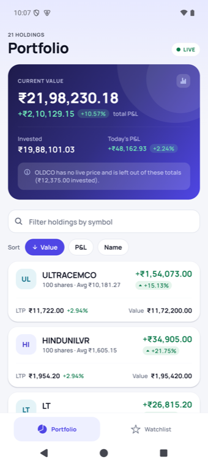
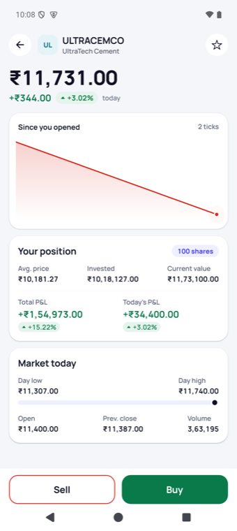
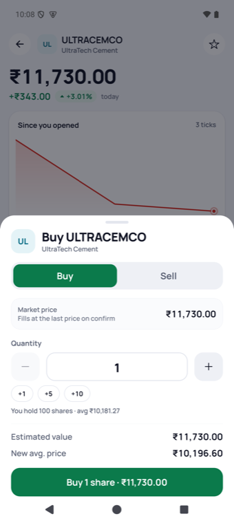
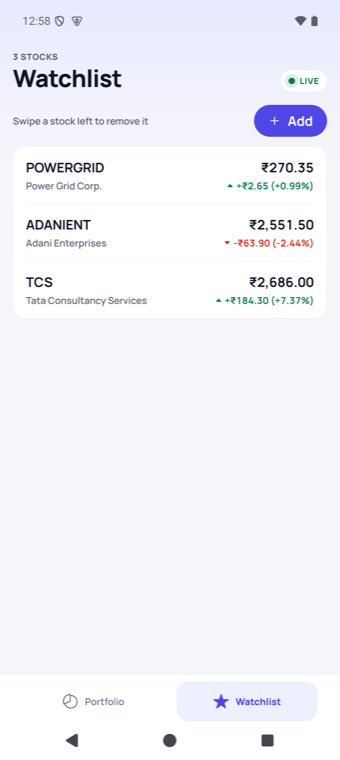
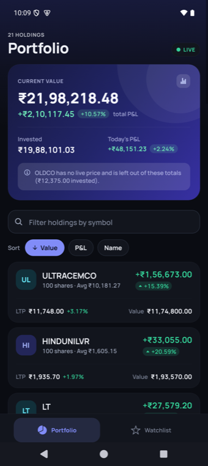
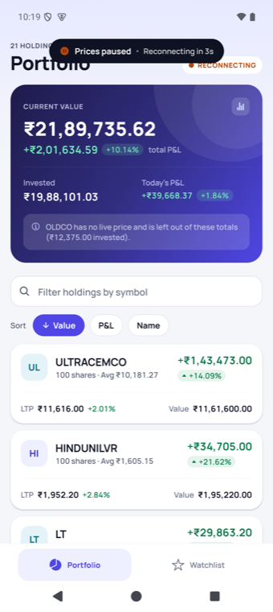
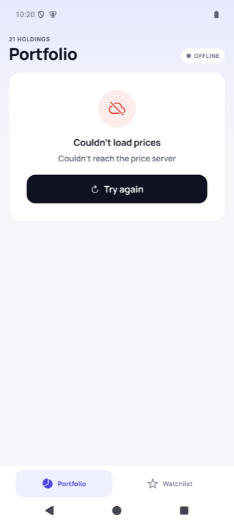
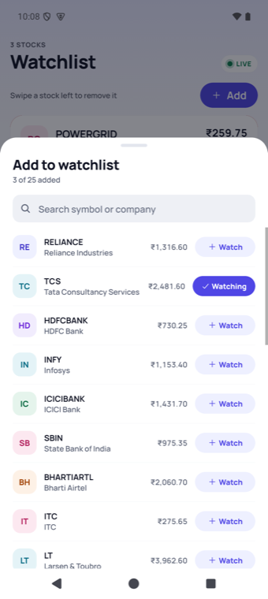

# Live Portfolio

A React Native (Expo, TypeScript strict) stock portfolio that stays correct and smooth while prices tick ~20 times a second.

| Portfolio | Stock detail | Buy sheet | Watchlist |
| --- | --- | --- | --- |
|  |  |  |  |

| Dark mode | Prices paused | Error + retry | Watchlist picker |
| --- | --- | --- | --- |
|  |  |  |  |

## Run it

Requirements: **Node 22** (Expo SDK 58 needs Node ≥ 22.13; `.nvmrc` pins it), an Android emulator or device.

```bash
nvm use          # Node 22
npm install
npx expo start   # then press "a" for Android: the CLI installs the matching Expo Go
```

A development build works too: `npx expo run:android`.

Checks:

```bash
npm test           # 114 unit tests (Jest, jest-expo)
npm run typecheck  # tsc --noEmit, strict + noUncheckedIndexedAccess
npm run lint       # eslint-config-expo, including the React Compiler hook rules
```

**Tested on:** Android 15 emulator (Pixel 9 Pro, API 35) in Expo Go, SDK 58, light and dark mode. iOS was not tested.

**Simulator controls:** long-press the LIVE pill to change the tick rate (5/20/50/100 per second), drop the connection for 10 s (watch the backoff and catch-up), and see pipeline counters (received / applied / late-dropped / commits).

## What's in it

- **Portfolio**: summary card where every figure has ₹ and %:
  - current value, with its change versus what you invested;
  - invested, with the share of your capital that has a live price ("99.38% priced");
  - total P&L and today's P&L.

  Then the live holdings list: sort by value / P&L / name (tap again to flip direction), filter-as-you-type, pull to refresh.
- **Watchlist**: last price and day change, add from the 25 symbols, swipe left to remove (with Undo), persisted across restarts.
- **Stock detail**: live price, day change, open/high/low/prev close/volume, a chart of the ticks received since the screen opened, and your position.
- **Buy / sell sheet**: quantity with validation, live estimated value, a new-average preview on buys and a realized-P&L preview on sells. It fills at the last price read at the moment you confirm.
- Every screen has loading (skeleton), empty, and error-with-retry states, plus a visible **"Prices paused"** banner. Light/dark follows the system. Numbers use Indian grouping (₹12,34,567.89).

## Architecture

```
src/
  domain/    pure TypeScript, no React: money, formatting, quotes & ticks, P&L, orders, sorting  (unit-tested)
  data/      bundled holdings CSV + OHLC REST client                                              (unit-tested)
  feed/      PriceFeed interface, the tick simulator, wire → domain normalisation                  (unit-tested)
  state/     zustand stores (market, portfolio, watchlist) and narrow selector hooks
  services/  MarketDataService (REST + feed → store), trading, composition root, app lifecycle    (unit-tested)
  ui/        theme tokens, motion tokens, shared components, chart
  features/  portfolio, watchlist, stock, trade, sheets, dev menu
  app/       Expo Router routes (thin: they only mount feature screens)
```

```
 REST: once per load, on refresh/retry, and one catch-up after a dropped connection
 ┌──────────────┐
 │ ohlcApi      │──────────────┐
 └──────────────┘              ▼
 ┌──────────────┐  WireTick  ┌────────────────────────────┐  ≤ 1 setState per frame  ┌──────────────┐
 │ PriceFeed    │──(rupees)─▶│ MarketDataService          │─────────────────────────▶│ marketStore  │
 │ (simulator,  │            │ normalise → buffer → flush │                          │ quotes(paise)│
 │  or a real   │◀─connect───│ applyTicks drops stale seq │   status on change only  │ load/refresh │
 │  socket)     │  subscribe │ watchdog · backoff         │─────────────────────────▶│ stream       │
 └──────────────┘            └────────────────────────────┘                          └──────┬───────┘
                                                                                           │ narrow selectors
 portfolioStore (holdings, fills) ◀── trading.placeMarketOrder (reads ltp at confirm)      ▼
 watchlistStore (AsyncStorage)                                         one row / the summary / the detail
```

The screens never talk to the feed; they read the store. `src/services/marketData.ts` is the only file that knows the feed is simulated. To use a real socket you would construct a WebSocket `PriceFeed` there and drop the `seed` call. The swap is already exercised: the service's tests run the whole pipeline against a second implementation, a hand-driven `FakeFeed`.

## State and re-render approach

**Choice: zustand vanilla stores + selector subscriptions (`useSyncExternalStore` underneath).** Not React context, which re-renders every consumer on every change, and not Redux (more ceremony, same subscription model). Stores are plain objects, so the pipeline and the order logic are tested without React.

The rules that keep renders scoped:

1. **The list's data is an array of symbols, not quotes.** It only changes when the visible order changes, so a tick never re-renders the `FlatList` itself.
2. **Each row subscribes to its own primitives**: holding, `ltp`, `prevClose`. A tick replaces only the changed symbol's quote object, and primitives compare by value. A tick for RELIANCE re-renders the RELIANCE row and nothing else; a volume-only tick re-renders no row at all.
3. **The summary uses a value-equality selector** (`useStoreWithEqualityFn`). Totals are recomputed on every flush (21 holdings: microseconds), but the card re-renders only when a number it shows changed, so ticks for watchlist-only symbols cost it nothing.
4. **Ticks are buffered and flushed once per animation frame**: one store commit per frame however fast the feed runs.
5. **Status changes are written only on transitions** (live ↔ paused ↔ reconnecting), never per tick.
6. **Live sorts are throttled.** Value/P&L order is re-checked every 1.5 s, skipped while the user is dragging the list, and committed only if it actually changed. Rows glide to their new place instead of jumping 20 times a second.
7. **Hidden screens are frozen.** The native stack freezes tabs under a pushed detail screen (`freezeOnBlur`). Expo Router's JS tabs silently ignore `freezeOnBlur` (they pass `false` to every tab screen), so each tab route wraps its screen in `react-freeze`.
8. **Animation runs on the UI thread** (Reanimated 4): price flashes, presses, the tab pill, the sheet. JS only starts them.
9. List hygiene: fixed-height rows with `getItemLayout`, stable `renderItem`/`keyExtractor`, memoised row halves (the static half skips every tick), and a memoised header element so typing in the search box never remounts it.

**Measured on the emulator** (temporary render counters, 10-second windows at 20 ticks/s, Portfolio visible):

| Component | Renders / 10 s |
| --- | --- |
| `PortfolioScreen`, toolbar, tab bar, LIVE pill | 0 |
| Row identity (static half of each row) | 0 |
| `HoldingRow` (all rows together) | ~122, i.e. one per real price change of a held symbol |
| `SummaryCard` | ~122 |
| Hidden Watchlist tab | 0 |
| Portfolio while the Watchlist tab is open | 0 (it was ~120 before the freeze fix) |
| Tabs under a pushed detail screen | 0 |

**Scrolling under ticks** (Android `dumpsys gfxinfo`, about 15 s of flinging the list while 20 ticks/s flow; dev build on the emulator, so a release build on a phone does better):

| Metric | Result |
| --- | --- |
| Frames rendered | 1,159 |
| Janky frames | 12 (1.0%) |
| Slow UI-thread frames | 2 |
| Median frame time | 17 ms (60 fps) |

To see it yourself: press `j` in the Expo CLI to open React Native DevTools, go to Profiler, record a few seconds. Each commit contains one `HoldingRow` and `SummaryCard`.

## Money and rounding

- **All money is integer paise** behind a branded `Paise` type, so the compiler refuses a rupee float where paise are expected. Floats exist only at the edges (API JSON, feed wire format) and are converted once with `Math.round(rupees × 100)`, because `1164.9 × 100` is `116489.99999999999`.
- **Holdings store a cost basis, not an average price.** Invested is exact; the average is derived (cost ÷ qty) and rounded only for display.
- **Buy**: cost += qty × fill price, exact, so the average becomes the true weighted average.
- **Sell** (average-cost method): the shares sold take out `cost × sold ÷ held`, computed exactly with BigInt and rounded half-up. That is the only rounding in the ledger, and realized P&L is computed from the same rounded figure, so remaining cost + released cost always equals the original.
- **Display rounding**: the average price and percentages are rounded half away from zero (2 dp for %).
- **Totals match the rows to the paisa.** Every row figure is an exact integer and the summary is their integer sum, so value − invested = P&L by construction (tested).
- **Guards**: quantities are whole numbers from 1 to 1,00,000 per order, which keeps `qty × price` far inside 2^53. A missing price is `null` all the way through and renders as `--`; it is never 0.
- **Today's P&L** compares shares held overnight with the previous close, and shares bought today with their fill price. Otherwise a buy would show a fake day gain the moment it fills. A sell consumes today's shares first (intraday square-off). It covers unrealized P&L on current holdings, like a broker's holdings view; realized P&L is shown on the fill.

## A holding with no price (OLDCO)

OLDCO is requested from the API like everything else. The API leaves it out, so it has no quote.

- **Its row** shows quantity, average and cost; LTP, value and P&L show `--`. In value/P&L sorts it always goes last.
- **The summary leaves it out of all four totals and says so.** The note names the symbol and its invested amount ("OLDCO has no live price and is left out of these totals (₹12,375.00 invested)").
- **The Invested figure shows the coverage as a number.** "99.38% priced" is ₹19,88,101.03 ÷ (₹19,88,101.03 + ₹12,375.00), and it reads 100.00% when everything has a price.

Why this choice:

- Counting it as 0 would show a fake −100% loss.
- Including its cost in "Invested" but not in "Current value" would make the summary contradict itself: value − invested ≠ P&L.
- Blanking the whole summary would let one delisted stock hide 20 good prices.

Keeping value, invested and P&L on the same priced set means the three numbers always reconcile with each other and with the rows; the missing piece is shown rather than guessed. The detail screen explains that there is no live price, and trading is disabled, because there is no honest price to fill at.

## Price feed

`SimulatedPriceFeed` implements the same `PriceFeed` interface a socket client would (`connect`, `disconnect`, `subscribe`, `onTick`, `onStateChange`):

- About 20 ticks/s with jittered gaps.
- Each tick moves one symbol by at most ±0.2%, snapped to NSE price-band tick sizes (₹0.01 under ₹250 up to ₹5 above ₹20,000).
- Partial ticks carry only the changed fields: `ltp`, `high`, `low`, `volume`.
- Sequence numbers increase per symbol. About 2% of ticks are held back and delivered right after a newer tick for the same symbol, so they are genuinely late and out of order.
- A 5-second silence happens roughly once a minute; the connection stays open.

The consumer (`MarketDataService`):

- Validates every tick and converts it to paise.
- Drops any tick whose seq isn't newer (≈2.1% measured on device).
- Keeps low ≤ ltp ≤ high itself, because the tick that carried a new extreme may be the late one it dropped.
- Shows "Prices paused" after 1.5 s without ticks.
- Reconnects after a real drop with jittered exponential backoff (1, 2, 4, 8, 15 s), then does one REST catch-up (rate-limited to one per 30 s).
- Pauses streaming in the background.

The REST API is a shared test server, so it is called once per load, on pull-to-refresh, on Retry, and on that catch-up. It is never polled.

## Libraries and why

| Need | Choice | Why |
| --- | --- | --- |
| App framework | Expo SDK 58 (React Native 0.88, New Architecture) | Fastest route to a runnable Android build; Expo Go ships every native module used here |
| Navigation | Expo Router (native stack + JS tabs) | File routes stay thin; the native stack gives native transitions and `freezeOnBlur` |
| State | zustand (vanilla stores) | Selector subscriptions with no providers; stores are testable without React |
| Animation / gestures | Reanimated 4, Gesture Handler 3 | Animations and gestures run on the UI thread, independent of tick load |
| Chart | react-native-svg, hand-rolled | One small line chart; full control over re-renders, no heavy chart dependency |
| Persistence | AsyncStorage via zustand `persist` | The watchlist is a tiny list; values are sanitised on load |
| Lists | FlatList | 21–25 fixed-height rows; FlashList's recycling would add per-row animation-state pitfalls for no gain at this size |

## Design

The look comes from how established investing apps use colour (Zerodha Kite, Groww, Robinhood, Revolut, Upstox):

- **Calm base**: a cool-neutral, mostly flat surface.
- **One indigo brand colour**, used only for actions, selection and focus.
- **Green and red reserved for money**, so a colour always means one thing.
- **A deep-indigo gradient summary card.**
- **Never colour alone**: every gain or loss also carries ▲/▼ or a sign, and every text colour passes WCAG AA (4.5:1) in both themes.
- **Motion** decelerates into place with no overshoot (`src/ui/theme/motion.ts`). The only spring settles the sheet after a drag, and it is critically damped.
- **Manrope** with tabular figures, so live digits don't change width.

Two platform quirks worth knowing:

- Manrope has a ligature that draws `--` as one long dash, and `fontVariant: no-common-ligatures` is dropped by the New Architecture's text layer. `AppText` inserts a zero-width non-joiner between the hyphens so missing values still read as `--`.
- Expo Router's JS tabs ignore `freezeOnBlur` (see the re-render section above).

## Tests

114 unit tests cover:

- money maths and rounding;
- Indian formatting;
- P&L, day P&L and summary reconciliation, including unpriced holdings;
- order validation, weighted-average buys and average-cost sells;
- sorting with unpriced rows last;
- CSV parsing;
- API parsing, on a recorded response fixture (tests never hit the shared server);
- the simulator: rate, ±0.2% moves on the tick grid, ~2% late ticks, silences, outages, subscriptions;
- the service pipeline: batching, stale drops, paused/live, backoff and catch-up, refresh failure, retry;
- trading consistency (holdings and summary after buys and sells);
- watchlist persistence across a simulated restart.

## Skipped, and what I'd do next

Done from the stretch list:
- Price flash on the UI thread.
- Reconnect with backoff plus a catch-up REST fetch.
- Simulator dev menu (tick rate, force disconnect).

Not done:
- Limit orders.
- An orders-history screen. Fills are already recorded in the store.

With another day:
- **Persist holdings and fills**, with an IST day rollover for "today's" shares. Today, holdings reset to the bundled CSV on each launch; only the watchlist persists, as the brief requires.
- **A real `WebSocketPriceFeed`** behind the same interface: JSON parsing, heartbeats, and a per-session sequence baseline (a server that restarts numbering must not look permanently stale).
- **Component tests** that assert render isolation, using the React Profiler API in Jest, so a regression fails CI rather than showing up in DevTools.
- **E2E flows** with Maestro: buy/sell, swipe remove, offline retry.
- **Colour-vision-friendly palette option**, a full screen-reader pass, and testing on iOS.
- **Market-hours awareness**, so "paused" vs "market closed" is explicit outside 9:15–15:30 IST.
- **A richer chart**: scrubbing and time labels.

## Time spent

Roughly 2.5 hours, built with an AI coding assistant (allowed by the brief). Update this with your own review and walkthrough time before submitting.
